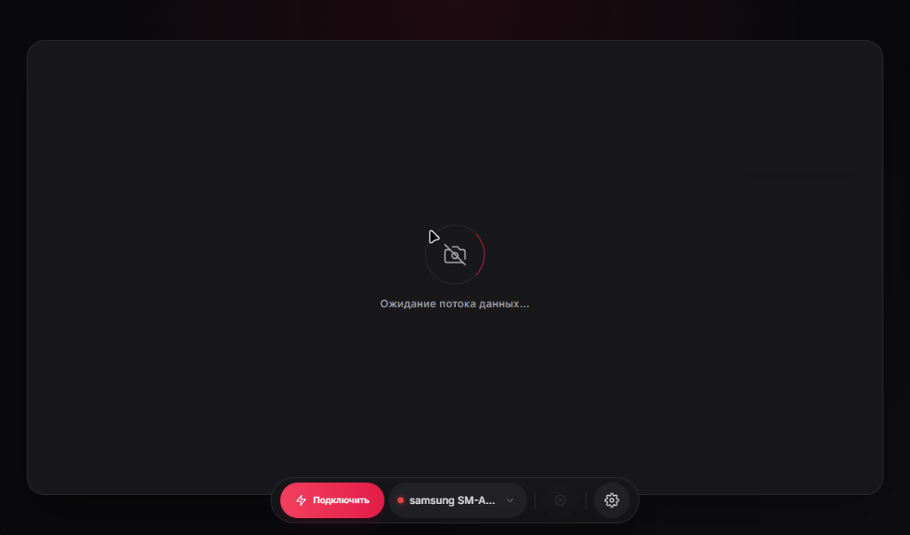

# VirtualCamNative - PC Client & Virtual Driver

> Ultra-Low-Latency, High-Performance DirectShow & Media Foundation Virtual Camera and Microphone for Windows powered by Android hardware acceleration.

<p align="center">
  <b>Language / Мова / Язык:</b><br>
  <a href="#virtualcamnative---pc-client--virtual-driver">English</a> • 
  <a href="#virtualcamnative---руководство-на-русском">Русский</a> • 
  <a href="#virtualcamnative---посібник-українською">Українська</a>
</p>

[](https://github.com/dimalinau-lab/Virtual-Camera/releases)
[](https://isocpp.org/)
[](https://docs.microsoft.com/en-us/windows/win32/directshow/directshow)
[](https://ffmpeg.org/)
[](https://www.microsoft.com/)
[](https://github.com/dimalinau-lab/Virtual-Camera-Android)
[](LICENSE)

<p align="center">
  
  <br>
  <em>VirtualCamNative Desktop Dashboard (Motion Glass Bento UI with device selector and floating action dock)</em>
</p>

**VirtualCamNative** is an open-source, high-efficiency desktop client and system driver written in pure **C++20**. Serving as a lightweight alternative to proprietary tools like DroidCam and Iriun, it receives hardware-accelerated **HEVC (H.265)** video and uncompressed **48 kHz PCM** audio over USB or Wi-Fi. Frames are decoded on GPU (`D3D11VA` / `NVDEC` / FFmpeg) and routed into native **DirectShow & Media Foundation** virtual camera and microphone devices, delivering plug-and-play compatibility in **Discord, OBS Studio, Zoom, Telegram, and WebRTC browsers** with ultra-low latency.

---

## Technical Specifications

| Parameter | Specification | Details |
| :--- | :--- | :--- |
| **Video Resolutions** | 4K UHD (3840x2160), 1080p FHD (1920x1080), 720p HD (1280x720) | Dynamic DirectShow pin list (`3840x2160`, `1920x1080`, `1280x720`, `960x540`, `640x360` 16:9 @ 30 FPS) synced to selected ceiling |
| **Pixel Formats** | `I420`, `NV12`, `RGB24` | Direct SSE2 `NV12 -> I420` conversion and SSE2 2x2 downscaling with zero OpenMP runtime dependency in driver |
| **Frame Rates** | 60 FPS, 30 FPS | Native 60 FPS capture (720p/1080p) + D3D11 motion-compensated 30->60 FPS frame synthesis |
| **Glass-to-Glass Latency** | ~10–15 ms (USB 3.0), < 30 ms (Wi-Fi 5 GHz) | Zero-copy `D3D11` GPU pipeline, Windows Shared Memory MMF, and unbuffered TCP |
| **Video Codec** | HEVC / H.265 | Android `MediaCodec` hardware encoder + PC `D3D11VA` / `NVDEC` / FFmpeg |
| **Audio Stream** | 48 kHz, 16-bit PCM | Dedicated TCP stream (`:8555`) + WASAPI Dual-Mic Mix & output routing |
| **Virtual Drivers** | DirectShow & Media Foundation COM | `VirtualCam.dll` (`"Native High-Speed Cam"` & `"VirtualCam Native Microphone"`) |
| **Network Ports** | `8000` (Web UI/API), `8080` (Phone API), `8554` (Video TCP), `8555` (Audio TCP), `8888` (UDP Discovery) | Automatic ADB port forwarding over USB |
| **OS Compatibility** | Windows 10 (1903+) / Windows 11 (x64) | Companion app requires Android 8.0+ (API 26–35) |

---

## Key Features

### Video & Rendering Pipeline
- **Zero-Copy D3D11 GPU Pipeline**: Decodes H.265 streams via `D3D11VA` / `NVDEC` directly into GPU textures, applies Studio Optics and orientation/aspect-ratio transforms on GPU, and writes `NV12` frames to Windows Shared Memory.
- **Browser-Optimized DirectShow `I420` & SSE2 Scaling**: `VirtualCam.dll` exposes `I420` alongside `NV12` and `RGB24`, converting `NV12 -> I420` and downscaling 2:1 via SSE2 intrinsics without OpenMP overhead, reducing `VideoCaptureService` CPU load in Chrome, Edge, and Brave.
- **Dynamic Resolution Ceiling Sync**: Automatically filters exposed DirectShow resolutions (`3840x2160` down to `640x360`) to match the active stream ceiling (720p / 1080p / 4K) so WebRTC browsers negotiate full HD or 4K cleanly.
- **Smooth 60 FPS Motion Synthesis**: Native 60 FPS hardware capture plus D3D11 GPU motion-compensated frame synthesis (`30 -> 60 FPS` below 4K).
- **Anti-Bufferbloat Socket Guard**: Non-blocking socket queue inspection via `ioctlsocket(FIONREAD)` drops stale buffered frames to prevent progressive latency buildup.
- **Sensor-Aware Orientation, Aspect & Freeze**: Seamless rotation (`0°`, `90°`, `180°`, `270°`), aspect switching (`9:16`, `4:3`, `16:9` with smooth 180 ms transition), mirroring, 180° flip, and instant Freeze Frame.
- **Rename-Swap Hot Driver Update**: Replaces `VirtualCam.dll` atomically via `VirtualCam.dll.pending` rename-swap even while Chrome, Discord, or OBS hold locks on the previous DLL, displaying an in-app changelog and single-restart reminder.

### Studio Optics & 3D LUT Color Engine
- **Direct3D 11 GPU Grading**: Executes color matrices and 3D LUT film profiles in pixel shaders with negligible CPU impact.
- **Physical Lens & Framing Control**:
  - Switch physical smartphone lenses (`0.5x`, `1x`, `2x`, `3x`, `5x`, `macro`, `front`) and hardware optical zoom (`0.5x–3.0x`) directly from the desktop dock.
  - Digital Zoom (`1.0x–3.0x`) with Pan (`X`, `Y`), plus quick toggles for **Face Auto-Framing**, **OIS/EIS Stabilization**, and **Phone Torch**.
  - Remote Camera2 Pro controls: Manual ISO, shutter exposure time, optical focus distance, and AWB presets.
- **Real-Time Color Adjustments & 6 Built-In LUT Profiles**:
  - Brightness (`-100` to `+100`), Contrast (`50%` to `200%`), Saturation (`0%` to `200%`), Warmth / Color Temp (`-50` to `+50`).
  - Profiles: **Natural**, **Teal & Orange**, **Warm Cinema**, **Noir B&W**, **Cyber Neon**, **Clean Studio**.

### Advanced Audio Suite
- **Lip-Sync Delay Compensation (`0–500 ms`)**: Circular PCM ring buffer for frame-accurate audio-video synchronization.
- **Dual-Mic Mix & WASAPI Routing**: Capture from **Phone Mic**, **Local PC Microphone**, or **Dual-Mic Mix** (`dual_mic` blending phone + PC mic simultaneously). Route output to the built-in **VirtualCam Native Microphone** DirectShow filter, speakers/headphones, or VB-Audio Virtual Cable.
- **Gain & Loudness Control**: Live microphone volume scaling (`0%–200%`) plus **AGC + Soft-Knee Limiter** (up to `+12 dB` boost with `tanh` clipping protection).
- **Studio Noise Suppression DSP**:
  - **Transient Switch De-Clicker**: Attenuates sharp mechanical keyboard and mouse switch impulses.
  - **Adaptive Noise Expander & Noise Gate**: Continuous noise-floor tracking with adjustable RMS threshold (`0.001–0.2`) to suppress PC fans and room hum.
  - **3-Band Parametric Equalizer**: Low-shelf (`120 Hz`), Mid peak (`2.2 kHz`), and High-shelf (`7.5 kHz`), adjustable `±15 dB`.

### Troll FX Distortion Suite
Real-time audio/video effects processed inline inside the D3D11 and Audio DSP pipelines:
- **GSM 2G Cellphone Buzz**: TDMA `216.7 Hz` interference buzz + incoming call burst (<kbd>Ctrl</kbd> + <kbd>Shift</kbd> + <kbd>G</kbd>).
- **Tactical Walkie-Talkie**: Bandpass filter (`380 Hz – 3.1 kHz`), overdrive, squelch, and Roger Beep.
- **Robot / Cyborg Voice**: `60 Hz` ring-modulator carrier voice.
- **90s Camcorder / CCTV**: Scanlines, blinking `REC` dot, and live OSD timestamp.
- **Fake Lag / Stutter**: Simulated packet drops with frame freezes and audio cutouts.
- **Overexposure / Flashbang**: Exponential bloom flare shader.
- **144p Pixelate**, **VHS Glitch**, **90s Bitcrush**, and **5 FPS Slideshow**.

### Desktop UX, Persistent Pairing & Hotkeys
- **2 Switchable Design Systems (`config.json` persistent)**:
  - **Motion Glass (`index2.html`, default)**: Modern Bento Dark Glass layout with spring physics, crisp `1px` borders, and quick action dock.
  - **Classic Aqua (`index3.html`)**: Mac OS X Aqua pinstripes, brushed aluminum surfaces, and gel buttons.
- **Trilingual Localization**: English (`EN`), Russian (`RU`), and Ukrainian (`UK`).
- **Persistent Device Memory & Phone Wake**: Recognizes paired phones across DHCP IP changes via persistent `client_id` / `auth_token` + device name without re-prompting. Supports waking/bringing the PC client forward from the phone via `/api/wake`.
- **System Tray & Background Operation**: Configurable `close_to_tray`, `start_with_windows`, hidden diagnostic console (`SW_HIDE`), and toggleable HUD Telemetry Overlay (`FPS`, bitrate, resolution, battery temp).
- **Window-Scoped Keyboard Shortcuts** *(active when the VirtualCam window is focused so browser shortcuts like `Ctrl+Shift+T` are never hijacked globally)*:
  - <kbd>Ctrl</kbd> + <kbd>Shift</kbd> + <kbd>1</kbd> / <kbd>2</kbd> : Switch Multi-Cam Channel 1 / 2
  - <kbd>Ctrl</kbd> + <kbd>Shift</kbd> + <kbd>M</kbd> : Mute / Unmute Microphone
  - <kbd>Ctrl</kbd> + <kbd>Shift</kbd> + <kbd>B</kbd> : Privacy Shield (Blackout shutter)
  - <kbd>Ctrl</kbd> + <kbd>Shift</kbd> + <kbd>C</kbd> : Flip Camera (Front / Back)
  - <kbd>Ctrl</kbd> + <kbd>Shift</kbd> + <kbd>S</kbd> : Toggle OIS / EIS Stabilization
  - <kbd>Ctrl</kbd> + <kbd>Shift</kbd> + <kbd>R</kbd> : Toggle Orientation (Portrait / Landscape)
  - <kbd>Ctrl</kbd> + <kbd>Shift</kbd> + <kbd>H</kbd> : Toggle HUD Telemetry Overlay
  - <kbd>Ctrl</kbd> + <kbd>Shift</kbd> + <kbd>F</kbd> : Freeze Frame
  - <kbd>Ctrl</kbd> + <kbd>Shift</kbd> + <kbd>P</kbd> : Toggle Picture-in-Picture / Floating Mode
  - <kbd>Ctrl</kbd> + <kbd>Shift</kbd> + <kbd>T</kbd> : Toggle Troll FX Distortion
  - <kbd>Ctrl</kbd> + <kbd>Shift</kbd> + <kbd>G</kbd> : Trigger 2G GSM Incoming Call Buzz Burst
  - <kbd>Ctrl</kbd> + <kbd>,</kbd> : Open Settings

---

## Comparison with Existing Solutions

| Feature | VirtualCamNative (C++) | DroidCam | Iriun Cam |
| :--- | :---: | :---: | :---: |
| **Language & Runtime** | **Native C++20 (Zero-bloat)** | C++ / C# | C++ / Objective-C |
| **Video Codec** | **HEVC / H.265 (Hardware)** | H.264 / MJPEG | H.264 / HEVC |
| **Frame Rate** | **60 FPS (Native & D3D11 Synth)** | Limited (Paid) | Limited |
| **Optics & 3D LUT** | **Yes (Multi-Lens, Color DSP, 6 LUTs)** | No | No |
| **Audio DSP & Dual-Mic** | **Yes (Lip-Sync, Gate, De-Clicker, AGC, EQ, Dual-Mic)** | No | No |
| **Troll FX & Shaders** | **Yes (10 Audio/Video Effects)** | No | No |
| **Modular UI Themes** | **Yes (Motion Glass, Classic Aqua)** | Fixed UI | Fixed UI |
| **Browser CPU Optimization** | **Yes (SSE2 I420 + Dynamic Caps)** | Standard | Standard |
| **Latency (USB)** | **~10–15 ms** | ~40–70 ms | ~30–50 ms |
| **Wi-Fi Discovery & Pairing** | **UDP :8888 + Persistent Token** | Manual IP | mDNS / Bonjour |
| **License** | **100% Free & Open Source (MIT)** | Proprietary (Freemium) | Proprietary (Watermarked) |

---

## System Architecture

```text
 +---------------------------------------------------------------------------------+
 |                        ANDROID CLIENT (HARDWARE SOURCE)                         |
 |           ( https://github.com/dimalinau-lab/Virtual-Camera-Android )           |
 |                                                                                 |
 | [ Camera2 + OpenGL ES (Auto-Framing / OIS-EIS) ] -> [ MediaCodec H.265 ] ->:8554|
 | [ AudioRecord (48kHz PCM) ]                                              ->:8555|
 | [ ControlServer :8080 ] <---- REST / Persistent Auth <---- [ UDP Beacon :8888 ] |
 +----------------------------------------|----------------------------------------+
                                          | TCP Video/Audio / HTTP REST / UDP Beacon
                                          v
 +---------------------------------------------------------------------------------+
 |                          VIRTUALCAM PC CLIENT (C++20)                           |
 |                                                                                 |
 |  [ UdpDiscoveryService ] ---> [ Device Selector + Persistent Pairing ]          |
 |  [ TcpReceiver ]               [ AudioReceiver (WASAPI Dual-Mic + Studio DSP) ] |
 |         |                                                                       |
 |         v (Anti-Bufferbloat FIONREAD Queue Guard)                               |
 |  [ NvdecDecoder (D3D11VA / NVDEC / FFmpeg) ]                                    |
 |         |                                                                       |
 |         v                                                                       |
 |  [ D3D11 Optics Pipeline (3D LUT, Zoom/Pan, Aspect, 60 FPS Synth, Troll FX) ]   |
 |         |                                   |                                   |
 |         v                                   v                                   |
 |  [ Local MJPEG Preview :8000 ]     [ Win32 Shared Memory MMF ]                  |
 |         |                                   | NV12 Frame Buffer + Sync Events   |
 |         v                                   |                                   |
 |  [ WebView2 Desktop GUI ]                   |                                   |
 |  (Motion Glass / Classic Aqua + Tray)       |                                   |
 +---------------------------------------------|-----------------------------------+
                                               v
 +---------------------------------------------------------------------------------+
 |                 NATIVE VIRTUAL DRIVERS (DIRECTSHOW & MEDIA FOUNDATION)          |
 |                                                                                 |
 |  [ VirtualCam.dll ] (SSE2 NV12->I420 & 2x2 Scaler + Rename-Swap Hot Update)     |
 |    |-- Video Capture Filter ("Native High-Speed Cam" — I420 / NV12 / RGB24)     |
 |    +-- Audio Capture Filter ("VirtualCam Native Microphone")                    |
 +----------------------------------------|----------------------------------------+
                                          | DirectShow / MF Capture Pins
                                          v
 +---------------------------------------------------------------------------------+
 |                              CONSUMING APPLICATIONS                             |
 |                                                                                 |
 |    Discord    |    OBS Studio    |    Zoom    |    Telegram    |    Browsers    |
 +---------------------------------------------------------------------------------+
```

---

## Quick Start

### Installation Options
- **Recommended (One-Click Installer):** Download and run **`VirtualCam_Setup_v3.1.0.exe`** from [Releases](https://github.com/dimalinau-lab/Virtual-Camera/releases). The installer places binaries into structured `adb/`, `ffmpeg/`, and `web/` folders and registers `VirtualCam.dll`.
- **Fast In-App Auto-Update (Hot-Swap + Rename-Swap):** Existing installations download **`VirtualCam_Update.zip`** from GitHub Releases and swap binaries seamlessly, including locked driver replacement via `VirtualCam.dll.pending`.
- **Android Companion App:** Download and install **`VirtualCam-v3.1.0.apk`** on your smartphone.
- **Manual / Portable:** Unpack `VirtualCam_Update.zip` and run `regsvr32.exe /s VirtualCam.dll` as Administrator.

### Prerequisites
- **Operating System:** Windows 10 (1903+) or Windows 11 (64-bit).
- **Companion App:** VirtualCam Companion (`VirtualCam-v3.1.0.apk`) on Android 8.0+.
- **Visual C++ Redistributable:** 2015–2022 (x64) (bundled with installer).

### USB Connection (Lowest Latency & Maximum Stability)
1. Enable **USB Debugging** on your phone (*Settings -> Developer Options -> USB Debugging*).
2. Connect your phone to your PC via USB.
3. Launch `VirtualCam.exe` (or `VirtualCamNative.exe`).
4. Click **Connect** / **USB** — ports `8080`, `8554`, and `8555` are mapped automatically via `adb\adb.exe`.

### Wi-Fi Connection (Wireless)
1. Connect your PC and smartphone to the same Wi-Fi network (5 GHz recommended).
2. Launch `VirtualCam.exe`. Devices are discovered automatically via UDP Beacon (`:8888`), and previously paired phones are recognized automatically even after a DHCP IP change.
3. Select your device from the dropdown and click **Connect**.
4. On first connection, choose **Always Allow** or **Only Once** on your phone screen.

---

## REST Control & Telemetry API

The local HTTP server on port `8000` serves the WebView2 UI and local control endpoints:

| Endpoint | Method | Payload / Query | Description |
| :--- | :---: | :--- | :--- |
| `/api/devices` | `GET` | - | Lists discovered devices: `[{"id":"...","name":"...","ip":"...","port":8080}]`. |
| `/api/paired_devices` | `GET` | - | Lists persistently paired devices stored in `config.json`. |
| `/api/pair_device` | `POST` | `?ip=192.168.1.X` | Initiates pairing prompt on phone and stores persistent `auth_token`. |
| `/api/unpair_device` | `POST` | `?id=...&ip=...` | Revokes pairing on phone and deletes stored device credentials. |
| `/api/connect_adb` | `POST` | - | Sets up ADB port forwarding (`8080`, `8554`, `8555`) and starts USB stream. |
| `/api/connect` | `POST` | `{"ip": "192.168.1.X", "auth_token": "..."}` | Connects and starts Wi-Fi stream using stored or provided token. |
| `/api/disconnect` | `POST` | - | Closes video/audio sockets and stops active stream. |
| `/api/wake` | `GET`/`POST` | - | Wakes/focuses VirtualCam PC client when triggered by companion app. |
| `/api/status` | `GET` | - | Returns active stream state, device info, and camera status. |
| `/api/telemetry` | `GET` | - | Returns live metrics: FPS, bitrate, resolution, and battery temperature. |
| `/api/freeze_frame` | `POST` | `?enabled=0\|1` | Freezes or unfreezes current output video frame. |
| `/api/phone/set_config` | `POST` | `{"fps": 60, "bitrate": 10000000, "resolution": "1080p"}` | Dynamically updates resolution (`720p`/`1080p`/`4k`), FPS, and bitrate. |
| `/api/phone/lens` | `GET`/`POST` | `?lens=0.5x \| 1x \| 2x \| 3x \| 5x \| macro \| front` | Switches physical camera sensor on smartphone. |
| `/api/phone/zoom` | `GET`/`POST` | `?ratio=1.0` | Sets optical/hardware zoom ratio on phone (`0.5x–3.0x`). |
| `/api/phone/action/(.*)` | `POST` | `{"action": "..."}` | Forwards actions (`switch_camera`, `toggle_torch`, `toggle_mic_mute`, `toggle_auto_framing`, `toggle_stabilization`, `toggle_privacy`, `set_camera_unit`). |
| `/api/phone/manual_exposure` | `POST` | `{"iso": 400, "exposure_time_ns": 16666667}` | Sets manual ISO and shutter speed on phone. |
| `/api/phone/manual_focus` | `POST` | `{"focus_distance": 2.5}` | Sets manual focus distance in diopters. |
| `/api/phone/awb` | `POST` | `{"awb_mode": "auto" \| "daylight" \| ...}` | Sets white balance mode on phone. |
| `/api/orientation` | `GET`/`POST` | `?mode=vertical\|horizontal` | Switches video orientation. |
| `/api/aspect_ratio` | `GET` | `?mode=9_16\|4_3\|16_9` | Sets output canvas aspect ratio (`0`, `1`, `2`). |
| `/api/mirror` / `/api/flip180` | `GET`/`POST` | `?enabled=0\|1` | Toggles horizontal mirror or 180° flip. |
| `/api/optics/color` | `GET`/`POST` | `?brightness=0&contrast=100&saturation=100&temp=0&preset=0` | Live D3D11 color grading & 3D LUT preset (`0..5`). |
| `/api/optics/zoom` | `GET`/`POST` | `?zoom=1.0&pan_x=0.0&pan_y=0.0` | Digital GPU zoom (`1.0–3.0`) and pan framing. |
| `/api/optics/get` / `/api/optics/reset` | `GET`/`POST` | - | Reads or resets Studio Optics settings. |
| `/api/audio_volume` | `GET`/`POST` | `?val=1.0` | Sets microphone output gain (`0.0–2.0`). |
| `/api/audio_delay` | `GET`/`POST` | `?val=50` | Sets Lip-Sync audio delay (`0–500` ms). |
| `/api/audio_noisegate` | `GET`/`POST` | `?enabled=1&threshold=0.015` | Configures Noise Gate DSP threshold (`0.001–0.2`). |
| `/api/audio_ai_noise` | `GET`/`POST` | `?enabled=1` | Toggles adaptive spectral noise expander. |
| `/api/audio_agc` | `GET`/`POST` | `?enabled=1` | Toggles AGC & soft-knee limiter (`+12 dB` max). |
| `/api/audio_declicker` | `GET`/`POST` | `?enabled=1` | Toggles transient keyboard/mouse de-clicker. |
| `/api/audio_eq` | `GET`/`POST` | `?low=0&mid=0&high=0` | 3-band EQ (`120 Hz`, `2.2 kHz`, `7.5 kHz`, `±15 dB`). |
| `/api/audio/devices` / `/api/audio/device` | `GET`/`POST` | `?id=phone\|dual_mic\|default\|{GUID}` | Lists/selects audio capture input (Phone, Dual-Mic Mix, PC Mic). |
| `/api/audio/output_devices` / `/api/audio/output_device` | `GET`/`POST` | `?id=vcam_only\|{GUID}` | Lists/selects audio output (VirtualCam Mic or WASAPI render device). |
| `/api/multicam` | `GET`/`POST` | `?channel=1\|2&ip1=...&ip2=...` | Dual-camera Wi-Fi channel switching. |
| `/api/navigate` | `GET`/`POST` | `?skin=index2.html\|index3.html` | Switches between Motion Glass and Classic Aqua skins. |
| `/api/app_settings` | `GET`/`POST` | `?close_to_tray=1&show_console=0&show_hud_stats=0` | Configures tray behavior, diagnostic console, startup, and HUD overlay. |
| `/api/update/check` / `download` / `status` / `install` / `ack_notice` | `GET`/`POST` | - | Checks GitHub Releases, downloads, hot-swaps, and acknowledges release notes. |
| `/api/get_config` / `/api/save_file` / `/api/reset_config` | `GET`/`POST` | `{ ... }` | Reads, saves, or resets `config.json`. |
| `/api/troll` / `/api/troll/gsm_burst` | `GET`/`POST` | `?fps_5=1&pixelate=8&glitch=1&bitcrush=1&overexposure=1&gsm_voice=1&walkie_talkie=1&robot_voice=1&cctv=1&fake_lag=1` | Live Troll FX parameters and 1.4s GSM burst trigger. |
| `/stream` | `GET` | - | Multipart MJPEG stream for WebView2 UI preview. |

---

## Building from Source

### Requirements
- **CMake:** Version 3.20 or newer.
- **Compiler:** Microsoft Visual C++ (MSVC) v143 (Visual Studio 2022) with C++20 support and OpenMP.
- **FFmpeg:** Shared Windows x64 GPL build (from [BtbN FFmpeg-Builds](https://github.com/BtbN/FFmpeg-Builds/releases), providing `avcodec-63.dll`, `avutil-61.dll`, `swscale-10.dll`).
- **Build Tool:** Ninja (recommended) or MSBuild.

### Build & Test Steps (CMake)
```cmd
git clone https://github.com/dimalinau-lab/Virtual-Camera.git
cd Virtual-Camera
cmake -B build -G Ninja -DCMAKE_BUILD_TYPE=Release -DFFMPEG_ROOT="D:/ffmpeg-master-latest-win64-gpl-shared"
cmake --build build --config Release
ctest --test-dir build --output-on-failure
```
Output binaries (`VirtualCam.exe`, `VirtualCam.dll`, `WebView2Loader.dll`) and `adb/`, `ffmpeg/`, `web/` assets are placed in `bin/`.

---

## Driver Registration

The installer and app automatically register `VirtualCam.dll` when run with administrator privileges. To register or unregister manually:

```cmd
:: Register virtual camera and microphone driver (Run as Administrator)
regsvr32.exe /s bin\VirtualCam.dll

:: Unregister driver
regsvr32.exe /u /s bin\VirtualCam.dll
```

---

## Companion Android App

For the mobile streamer component, see the companion repository:  
**[Virtual-Camera-Android on GitHub](https://github.com/dimalinau-lab/Virtual-Camera-Android)**

---

## License

This project is licensed under the **MIT License**. See [`LICENSE`](LICENSE) for details.

---
---

# VirtualCamNative - Руководство на русском

> Высокопроизводительная виртуальная камера и микрофон DirectShow & Media Foundation для Windows со сверхнизкой задержкой на базе аппаратного ускорения Android.

<p align="center">
  
  <br>
  <em>Панель управления VirtualCamNative (интерфейс Motion Glass Bento с выбором устройства и нижним доком управления)</em>
</p>

**VirtualCamNative** — это клиент и системный драйвер для Windows с открытым исходным кодом, написанный на чистом **C++20**. Являясь легкой альтернативой проприетарным решениям (DroidCam, Iriun), он принимает аппаратный видеопоток **HEVC (H.265)** и несжатый **48 кГц PCM**-звук по кабелю USB или сети Wi-Fi. Поток декодируется на GPU (`D3D11VA` / `NVDEC` / FFmpeg) и передается в нативный **COM-драйвер виртуальной камеры и микрофона (DirectShow / Media Foundation)**, обеспечивая работу в **Discord, OBS Studio, Zoom, Telegram и WebRTC-браузерах** со сверхнизкой задержкой.

---

## Технические характеристики

| Параметр | Значение | Описание |
| :--- | :--- | :--- |
| **Разрешения видео** | 4K UHD (3840x2160), 1080p FHD (1920x1080), 720p HD (1280x720) | Динамический список разрешений DirectShow (`3840x2160`, `1920x1080`, `1280x720`, `960x540`, `640x360` 16:9 @ 30 FPS) под выбранный потолок |
| **Форматы пикселей** | `I420`, `NV12`, `RGB24` | Прямая SSE2-конвертация `NV12 -> I420` и SSE2 2x2 даунскейл без зависимости от OpenMP в драйвере |
| **Частота кадров** | 60 FPS, 30 FPS | Нативный захват 60 FPS (720p/1080p) и синтез 30->60 FPS на GPU D3D11 |
| **Задержка (Glass-to-Glass)** | ~10–15 мс (USB 3.0), < 30 мс (Wi-Fi 5 ГГц) | Конвейер `D3D11` zero-copy, разделяемая память Windows MMF и небуферизованный TCP |
| **Видеокодек** | HEVC / H.265 | Аппаратный энкодер `MediaCodec` (Android) + `D3D11VA` / `NVDEC` / FFmpeg (ПК) |
| **Аудиопоток** | 48 кГц, 16 бит PCM | Выделенный TCP-поток (`:8555`) + WASAPI Dual-Mic Mix и выбор вывода |
| **Виртуальные драйверы** | DirectShow & Media Foundation COM | `VirtualCam.dll` (`"Native High-Speed Cam"` и `"VirtualCam Native Microphone"`) |
| **Сетевые порты** | `8000` (Web UI/API), `8080` (Phone API), `8554` (Video TCP), `8555` (Audio TCP), `8888` (UDP Discovery) | Автоматический проброс портов через ADB при подключении по USB |
| **Совместимость с ОС** | Windows 10 (1903+) / Windows 11 (x64) | Android-приложение требует Android 8.0+ (API 26–35) |

---

## Ключевые возможности

### Видеоконвейер и рендеринг
- **Zero-Copy GPU-конвейер D3D11**: Декодирование H.265 через `D3D11VA` / `NVDEC` напрямую в текстуры GPU, выполнение цветокоррекции и трансформаций на видеокарте и запись `NV12` в разделяемую память Windows Shared Memory.
- **Оптимизация браузеров (I420 + SSE2)**: `VirtualCam.dll` отдаёт поток `I420` с SSE2-конвертацией `NV12 -> I420` и SSE2 2x2 даунскейлом без OpenMP, снижая нагрузку `VideoCaptureService` в Chrome, Edge и Brave.
- **Динамический потолок разрешений**: Список пинов DirectShow (`3840x2160` .. `640x360`) автоматически подстраивается под выбранное разрешение (720p / 1080p / 4K), чтобы браузеры корректно открывали Full HD и 4K.
- **Плавные 60 FPS**: Нативная частота 60 FPS и компенсация движения D3D11 для синтеза промежуточных кадров (`30 -> 60 FPS` ниже 4K).
- **Защита от накопления задержки (Anti-Bufferbloat)**: Неблокующая проверка очереди сокета через `ioctlsocket(FIONREAD)` отбрасывает устаревшие кадры.
- **Ориентация, пропорции и стоп-кадр**: Поворот (`0°`, `90°`, `180°`, `270°`), форматы `9:16`, `4:3`, `16:9` с плавной анимацией (180 мс), зеркалирование, переворот 180° и Freeze Frame.
- **Надёжное обновление драйвера (Rename-Swap)**: Замена `VirtualCam.dll` через отложенный `VirtualCam.dll.pending` проходит без отката даже при открытых Chrome, Discord и OBS, с отображением списка изменений и напоминанием о перезапуске.

### Студийная оптика Studio Optics и 3D LUT
- **Аппаратное ускорение Direct3D 11**: Пиксельные шейдеры GPU для цветокоррекции и 3D LUT с минимальной нагрузкой на CPU.
- **Физические объективы и зум**:
  - Переключение модулей камеры смартфона (`0.5x`, `1x`, `2x`, `3x`, `5x`, `macro`, `front`) и аппаратного оптического зума (`0.5x–3.0x`).
  - Цифровой зум (`1.0x–3.0x`) с панорамированием (`X`, `Y`), быстрые кнопки **Автокадрирования (Auto-Framing)**, **Стабилизации (OIS/EIS)** и **Фонарика**.
  - Удалённое ручное управление Camera2: ISO, выдержка, фокус и баланс белого (AWB).
- **Цветокоррекция и 6 встроенных LUT-профилей**:
  - Яркость (`-100..+100`), Контрастность (`50%..200%`), Насыщенность (`0%..200%`), Теплота (`-50..+50`).
  - Профили: **Natural**, **Teal & Orange**, **Warm Cinema**, **Noir B&W**, **Cyber Neon**, **Clean Studio**.

### Студийный звуковой тракт
- **Компенсация рассинхронизации (0–500 мс)**: Кольцевой буфер задержки PCM для точного Lip-Sync.
- **Dual-Mic Mix и WASAPI-маршрутизация**: Источник звука — **Микрофон телефона**, **Микрофон ПК** или **Dual-Mic Mix** (одновременное микширование обоих микрофонов). Вывод — во встроенный виртуальный микрофон **"VirtualCam Native Microphone"**, в динамики/наушники или VB-Audio Virtual Cable.
- **Громкость и AGC**: Регулировка усиления (`0%–200%`), автоматическая регулировка громкости (AGC до `+12 dB`) и мягкий лимитер (`tanh`).
- **DSP-обработка шума**:
  - **Подавитель кликов (De-Clicker)**: Сглаживание резких импульсных щелчков механической клавиатуры и мыши.
  - **Адаптивный экспандер шума и Noise Gate**: Динамическое отслеживание шумового пола и настраиваемый порог RMS (`0.001–0.2`) от шума кулеров.
  - **3-полосный параметрический эквалайзер**: Низкие (`120 Гц`), Средние (`2.2 кГц`), Высокие (`7.5 кГц`), `±15 dB`.

### Пакет эффектов (Troll FX)
- **Помехи 2G GSM**: Треск TDMA `216.7 Гц` при речи + сигнал входящего вызова (<kbd>Ctrl</kbd> + <kbd>Shift</kbd> + <kbd>G</kbd>).
- **Рация Walkie-Talkie**: Полосовой фильтр (`380 Гц – 3.1 кГц`), перегруз и сигнал Roger Beep.
- **Голос Робота / Киборга**: Кольцевая модуляция `60 Гц`.
- **Камера наблюдения 90-х / CCTV**, **Искусственный лаг (Fake Lag)**, **Пересвет (Flashbang)**, **Пикселизация 144p**, **Глитч VHS**, **Биткраш 90-х**, **Слайдшоу 5 FPS**.

### Интерфейс, память устройств и клавиши
- **2 темы интерфейса (`config.json`)**:
  - **Motion Glass (`index2.html`, по умолчанию)**: Bento Dark Glass с пружинной физикой и компактным доком.
  - **Classic Aqua (`index3.html`)**: Стиль Mac OS X Aqua с полосатой текстурой и гелевыми кнопками.
- **Трёхъязычная локализация**: Английский (EN), Русский (RU) и Украинский (UK).
- **Память сопряжения и пробуждение ПК**: Сохранённые телефоны распознаются по постоянному токену и имени устройства даже после смены IP по DHCP; поддерживается удалённое пробуждение окна ПК со смартфона (`/api/wake`).
- **Системный трей и HUD**: Настройка `close_to_tray`, автозапуск с Windows, скрытая диагностическая консоль (`SW_HIDE`) и HUD-телеметрия.
- **Локальные горячие клавиши окна VirtualCam** *(глобальный перехват отключён, чтобы не конфликтовать с сочетаниями вроде `Ctrl+Shift+T` в браузерах)*:
  - <kbd>Ctrl</kbd> + <kbd>Shift</kbd> + <kbd>1</kbd> / <kbd>2</kbd> : Переключить канал Multi-Cam 1 / 2
  - <kbd>Ctrl</kbd> + <kbd>Shift</kbd> + <kbd>M</kbd> : Отключить / включить микрофон
  - <kbd>Ctrl</kbd> + <kbd>Shift</kbd> + <kbd>B</kbd> : Шторка приватности (Blackout)
  - <kbd>Ctrl</kbd> + <kbd>Shift</kbd> + <kbd>C</kbd> : Переключить камеру (Фронт / Основная)
  - <kbd>Ctrl</kbd> + <kbd>Shift</kbd> + <kbd>S</kbd> : Включить / выключить стабилизацию (OIS/EIS)
  - <kbd>Ctrl</kbd> + <kbd>Shift</kbd> + <kbd>R</kbd> : Переключить ориентацию (Вертикаль / Горизонталь)
  - <kbd>Ctrl</kbd> + <kbd>Shift</kbd> + <kbd>H</kbd> : Переключить HUD-телеметрию
  - <kbd>Ctrl</kbd> + <kbd>Shift</kbd> + <kbd>F</kbd> : Стоп-кадр (Freeze Frame)
  - <kbd>Ctrl</kbd> + <kbd>Shift</kbd> + <kbd>P</kbd> : Режим мини-окна / PiP
  - <kbd>Ctrl</kbd> + <kbd>Shift</kbd> + <kbd>T</kbd> : Включить / выключить Troll FX
  - <kbd>Ctrl</kbd> + <kbd>Shift</kbd> + <kbd>G</kbd> : Запустить наводку помех GSM
  - <kbd>Ctrl</kbd> + <kbd>,</kbd> : Открыть настройки

---

## Быстрый запуск

### Способы установки
- **Рекомендуемый (в один клик):** Скачайте и запустите **`VirtualCam_Setup_v3.1.0.exe`** из раздела [Releases](https://github.com/dimalinau-lab/Virtual-Camera/releases). Инсталлятор развернёт модули в `adb/`, `ffmpeg/`, `web/` и зарегистрирует `VirtualCam.dll`.
- **Быстрое автообновление (Hot-Swap + Rename-Swap):** При наличии установленной версии клиент загружает **`VirtualCam_Update.zip`** и бесшовно обновляет файлы, включая заблокированный драйвер `VirtualCam.dll`.
- **Приложение Android:** Установите **`VirtualCam-v3.1.0.apk`** на смартфон.
- **Портативная версия:** Распакуйте `VirtualCam_Update.zip` и выполните `regsvr32.exe /s VirtualCam.dll` от имени администратора.

### Системные требования
- **ОС:** Windows 10 (1903+) или Windows 11 (64-бит).
- **Смартфон:** Установленный клиент VirtualCam Companion (`VirtualCam-v3.1.0.apk`) на Android 8.0+.
- **Visual C++ Redistributable:** 2015–2022 (x64) (включён в инсталлятор).

### Подключение по USB (Минимальная задержка)
1. Включите **Отладку по USB** на смартфоне (*Настройки -> Для разработчиков -> Отладка по USB*).
2. Подключите смартфон к ПК кабелем USB.
3. Запустите `VirtualCam.exe` (или `VirtualCamNative.exe`).
4. Нажмите **Подключить** / **USB** — порты `8080`, `8554` и `8555` пробрасываются автоматически через `adb\adb.exe`.

### Беспроводное подключение по Wi-Fi
1. Подключите ПК и смартфон к одной сети Wi-Fi (рекомендуется 5 ГГц).
2. Запустите `VirtualCam.exe`. Устройство определится автоматически через UDP Beacon (`:8888`), а сохранённые телефоны узнаются даже после смены IP по DHCP.
3. Выберите телефон в списке и нажмите **Подключить**.
4. При первом сопряжении выберите **Всегда разрешать** или **Только один раз** на экране смартфона.

---

## Сборка из исходников

```cmd
git clone https://github.com/dimalinau-lab/Virtual-Camera.git
cd Virtual-Camera
cmake -B build -G Ninja -DCMAKE_BUILD_TYPE=Release -DFFMPEG_ROOT="D:/ffmpeg-master-latest-win64-gpl-shared"
cmake --build build --config Release
ctest --test-dir build --output-on-failure
```

---

## Ручная регистрация COM-драйвера

```cmd
:: Регистрация драйвера виртуальной камеры и микрофона (от имени Администратора)
regsvr32.exe /s bin\VirtualCam.dll

:: Отмена регистрации драйвера
regsvr32.exe /u /s bin\VirtualCam.dll
```

---

## Лицензия

Проект распространяется под лицензией **MIT License**. Подробности в файле [`LICENSE`](LICENSE).

---
---

# VirtualCamNative - Посібник українською

> Високопродуктивна віртуальна камера та мікрофон DirectShow & Media Foundation для Windows із наднизькою затримкою та апаратним прискоренням Android.

<p align="center">
  
  <br>
  <em>Панель керування VirtualCamNative (інтерфейс Motion Glass Bento із вибором пристрою та нижнім доком керування)</em>
</p>

**VirtualCamNative** — це нативний клієнт і системний драйвер для Windows з відкритим вихідним кодом, створений на базі **C++20**. Як легка альтернатива пропрієтарним програмам (DroidCam, Iriun), він приймає апаратний відеопотік **HEVC (H.265)** та нестиснений **48 кГц PCM**-звук через USB-кабель або Wi-Fi. Потік декодується на GPU (`D3D11VA` / `NVDEC` / FFmpeg) і передається у нативний **COM-драйвер DirectShow / Media Foundation**, забезпечуючи стабільну роботу в **Discord, OBS Studio, Zoom, Telegram та WebRTC-браузерах** із мінімальною затримкою.

---

## Технічні характеристики

| Параметр | Значення | Опис |
| :--- | :--- | :--- |
| **Роздільна здатність** | 4K UHD (3840x2160), 1080p FHD (1920x1080), 720p HD (1280x720) | Динамічний список роздільностей DirectShow (`3840x2160`, `1920x1080`, `1280x720`, `960x540`, `640x360` 16:9 @ 30 FPS) під обрану стелю |
| **Формати пікселів** | `I420`, `NV12`, `RGB24` | Пряма SSE2-конвертація `NV12 -> I420` та SSE2 2x2 даунскейл без залежності від OpenMP у драйвері |
| **Частота кадрів** | 60 FPS, 30 FPS | Нативний захват 60 FPS (720p/1080p) та синтез 30->60 FPS на GPU D3D11 |
| **Затримка (Glass-to-Glass)** | ~10–15 мс (USB 3.0), < 30 мс (Wi-Fi 5 ГГц) | Конвеєр `D3D11` zero-copy, спільна пам'ять Windows MMF та небуферизований TCP |
| **Відеокодек** | HEVC / H.265 | Апаратний енкодер `MediaCodec` (Android) + `D3D11VA` / `NVDEC` / FFmpeg (ПК) |
| **Аудіопотік** | 48 кГц, 16 біт PCM | Окремий TCP-потік (`:8555`) + WASAPI Dual-Mic Mix та вибір пристрою виводу |
| **Віртуальні драйвери** | DirectShow & Media Foundation COM | `VirtualCam.dll` (`"Native High-Speed Cam"` та `"VirtualCam Native Microphone"`) |
| **Мережеві порти** | `8000` (Web UI/API), `8080` (Phone API), `8554` (Video TCP), `8555` (Audio TCP), `8888` (UDP Discovery) | Автоматичне перенаправлення портів через ADB по USB |
| **Сумісність з ОС** | Windows 10 (1903+) / Windows 11 (x64) | Android-додаток вимагає Android 8.0+ (API 26–35) |

---

## Головні можливості

### Відеоконвеєр та рендеринг
- **Zero-Copy GPU-конвеєр D3D11**: Декодування H.265 через `D3D11VA` / `NVDEC` безпосередньо у текстури GPU, колірна корекція на відеокарті та запис `NV12` у спільну пам'ять Windows Shared Memory.
- **Оптимізація браузерів (I420 + SSE2)**: `VirtualCam.dll` віддає потік `I420` із SSE2-конвертацією `NV12 -> I420` та SSE2 2x2 даунскейлом без OpenMP, знижуючи навантаження `VideoCaptureService` у Chrome, Edge та Brave.
- **Динамічна стеля роздільної здатності**: Список пінів DirectShow (`3840x2160` .. `640x360`) автоматично підлаштовується під обрану роздільність (720p / 1080p / 4K).
- **Плавні 60 FPS**: Нативний захват 60 FPS і синтез проміжних кадрів на D3D11 GPU (`30 -> 60 FPS` нижче 4K).
- **Захист від накопичення буфера (Anti-Bufferbloat)**: Неблокуючий моніторинг черги сокета через `ioctlsocket(FIONREAD)` відкидає застарілі кадри.
- **Орієнтація, пропорції та стоп-кадр**: Поворот (`0°`, `90°`, `180°`, `270°`), формати `9:16`, `4:3`, `16:9` із плавним переходом (180 мс), дзеркалювання, розворот 180° і Freeze Frame.
- **Надійне оновлення драйвера (Rename-Swap)**: Заміна `VirtualCam.dll` через `VirtualCam.dll.pending` проходить без відкату навіть при відкритих Chrome, Discord чи OBS, із показом списку змін та нагадуванням про перезапуск.

### Студійна оптика Studio Optics та 3D LUT
- **Апаратне прискорення Direct3D 11**: Піксельні шейдери GPU для корекції кольору та 3D LUT із мінімальним навантаженням на процесор.
- **Фізичні об'єктиви та зум**:
  - Перемикання модулів смартфона (`0.5x`, `1x`, `2x`, `3x`, `5x`, `macro`, `front`) і апаратного оптичного зуму (`0.5x–3.0x`).
  - Цифровий зум (`1.0x–3.0x`) із панорамуванням (`X`, `Y`), швидкі кнопки **Автокадрування (Auto-Framing)**, **Стабілізації (OIS/EIS)** та **Ліхтарика**.
  - Віддалене ручне керування Camera2: ISO, витримка, фокус та баланс білого (AWB).
- **Колірна корекція та 6 вбудованих профілів LUT**:
  - Яскравість (`-100..+100`), Контрастність (`50%..200%`), Насиченість (`0%..200%`), Теплота (`-50..+50`).
  - Профілі: **Natural**, **Teal & Orange**, **Warm Cinema**, **Noir B&W**, **Cyber Neon**, **Clean Studio**.

### Професійний аудіотракт
- **Компенсація затримки Lip-Sync (0–500 мс)**: Кільцевий буфер PCM для точної синхронізації звуку з артикуляцією.
- **Dual-Mic Mix та WASAPI-маршрутизація**: Вибір входу — **Мікрофон телефона**, **Мікрофон ПК** або **Dual-Mic Mix** (одночасне мікшування обох мікрофонів). Вивід — у вбудований віртуальний мікрофон **"VirtualCam Native Microphone"**, динаміки/навушники або VB-Audio Virtual Cable.
- **Гучність та AGC**: Регулювання посилення (`0%–200%`), автоматичний рівень (AGC до `+12 dB`) та м'який лімітер (`tanh`).
- **DSP-придушення шуму**:
  - **Фільтр клацань (De-Clicker)**: Згладжування різких імпульсів механічної клавіатури та миші.
  - **Адаптивний експандер шуму та Noise Gate**: Динамічне відстеження фонового шуму і регульований поріг RMS (`0.001–0.2`).
  - **3-смуговий параметричний еквалайзер**: Низ (`120 Гц`), Середина (`2.2 кГц`), Верх (`7.5 кГц`), `±15 dB`.

### Пакет ефектів (Troll FX)
- **Перешкоди 2G GSM**: Тріск TDMA `216.7 Гц` під час мовлення + сигнал вхідного виклику (<kbd>Ctrl</kbd> + <kbd>Shift</kbd> + <kbd>G</kbd>).
- **Військова рація Walkie-Talkie**: Смуговий фільтр (`380 Гц – 3.1 кГц`), перевантаження і сигнал Roger Beep.
- **Голос Робота / Кіборга**: Кільцева модуляція `60 Гц`.
- **Камера спостереження 90-х / CCTV**, **Штучний лаг (Fake Lag)**, **Пересвіт (Flashbang)**, **Пікселізація 144p**, **Глітч VHS**, **Біткраш 90-х**, **Слайдшоу 5 FPS**.

### Інтерфейс, пам'ять пристроїв та клавіші
- **2 стилі інтерфейсу (`config.json`)**:
  - **Motion Glass (`index2.html`, за замовчуванням)**: Сучасний Bento Dark Glass із пружинною фізикою та доком керування.
  - **Classic Aqua (`index3.html`)**: Стиль Mac OS X Aqua зі смугастою текстурою та гелевими кнопками.
- **Тримовна локалізація**: Англійська (EN), Російська (RU) та Українська (UK).
- **Пам'ять сполучення та пробудження ПК**: Збережені телефони розпізнаються за постійним токеном та іменем пристрою навіть після зміни IP через DHCP; підтримується пробудження вікна ПК зі смартфона (`/api/wake`).
- **Системний трей і HUD**: Опція `close_to_tray`, автозапуск із Windows, прихована консоль діагностики (`SW_HIDE`) та HUD-телеметрія.
- **Локальні гарячі клавіші вікна VirtualCam** *(глобальне перехоплення вимкнене, щоб не блокувати комбінації на кшталт `Ctrl+Shift+T` у браузерах)*:
  - <kbd>Ctrl</kbd> + <kbd>Shift</kbd> + <kbd>1</kbd> / <kbd>2</kbd> : Перемкнути канал Multi-Cam 1 / 2
  - <kbd>Ctrl</kbd> + <kbd>Shift</kbd> + <kbd>M</kbd> : Вимкнути / увімкнути мікрофон
  - <kbd>Ctrl</kbd> + <kbd>Shift</kbd> + <kbd>B</kbd> : Шторка приватності (Blackout)
  - <kbd>Ctrl</kbd> + <kbd>Shift</kbd> + <kbd>C</kbd> : Перемкнути камеру (Фронт / Основна)
  - <kbd>Ctrl</kbd> + <kbd>Shift</kbd> + <kbd>S</kbd> : Увімкнути / вимкнути стабілізацію (OIS/EIS)
  - <kbd>Ctrl</kbd> + <kbd>Shift</kbd> + <kbd>R</kbd> : Перемкнути орієнтацію (Вертикаль / Горизонталь)
  - <kbd>Ctrl</kbd> + <kbd>Shift</kbd> + <kbd>H</kbd> : Перемкнути HUD-телеметрію
  - <kbd>Ctrl</kbd> + <kbd>Shift</kbd> + <kbd>F</kbd> : Стоп-кадр (Freeze Frame)
  - <kbd>Ctrl</kbd> + <kbd>Shift</kbd> + <kbd>P</kbd> : Режим міні-вікна / PiP
  - <kbd>Ctrl</kbd> + <kbd>Shift</kbd> + <kbd>T</kbd> : Увімкнути / вимкнути Troll FX
  - <kbd>Ctrl</kbd> + <kbd>Shift</kbd> + <kbd>G</kbd> : Запустити перешкоди GSM
  - <kbd>Ctrl</kbd> + <kbd>,</kbd> : Відкрити налаштування

---

## Швидкий старт

### Варіанти встановлення
- **Рекомендований (в один клік):** Завантажте та запустіть **`VirtualCam_Setup_v3.1.0.exe`** з розділу [Releases](https://github.com/dimalinau-lab/Virtual-Camera/releases). Інсталятор розгортає модулі в `adb/`, `ffmpeg/`, `web/` та автоматично реєструє `VirtualCam.dll`.
- **Швидке безшовне автооновлення (Hot-Swap + Rename-Swap):** Програма завантажує архів **`VirtualCam_Update.zip`** і замінює бінарні файли, включаючи заблокований драйвер `VirtualCam.dll`.
- **Мобільний додаток Android:** Встановіть **`VirtualCam-v3.1.0.apk`** на смартфон.
- **Портативна версія:** Розпакуйте `VirtualCam_Update.zip` та виконайте `regsvr32.exe /s VirtualCam.dll` від імені адміністратора.

### Системні вимоги
- **ОС:** Windows 10 (1903+) або Windows 11 (64-біт).
- **Мобільний додаток:** Клієнт VirtualCam Companion (`VirtualCam-v3.1.0.apk`) на Android 8.0+.
- **Visual C++ Redistributable:** 2015–2022 (x64) (входить до інсталятора).

### Підключення через USB (Найкраща якість та стабільність)
1. Увімкніть **Налагодження через USB** на смартфоні (*Налаштування -> Параметри розробника -> Налагодження через USB*).
2. Підключіть телефон до ПК через USB-кабель.
3. Запустіть `VirtualCam.exe` (або `VirtualCamNative.exe`).
4. Натисніть **Підключити** / **USB** — порти `8080`, `8554` та `8555` перенаправляються автоматично через `adb\adb.exe`.

### Бездротове підключення через Wi-Fi
1. Підключіть ПК та смартфон до однієї мережі Wi-Fi (5 ГГц рекомендовано).
2. Запустіть `VirtualCam.exe`. Пристрій визначиться автоматично через UDP Beacon (`:8888`), а збережені телефони впізнаються навіть після зміни IP через DHCP.
3. Оберіть смартфон зі списку та натисніть **Підключити**.
4. Під час першого підключення оберіть **Дозволяти завжди** або **Лише один раз** на екрані телефона.

---

## Компіляція з вихідного коду

```cmd
git clone https://github.com/dimalinau-lab/Virtual-Camera.git
cd Virtual-Camera
cmake -B build -G Ninja -DCMAKE_BUILD_TYPE=Release -DFFMPEG_ROOT="D:/ffmpeg-master-latest-win64-gpl-shared"
cmake --build build --config Release
ctest --test-dir build --output-on-failure
```

---

## Реєстрація віртуального COM-драйвера

```cmd
:: Реєстрація драйвера віртуальної камери та мікрофона (від імені Адміністратора)
regsvr32.exe /s bin\VirtualCam.dll

:: Скасування реєстрації драйвера
regsvr32.exe /u /s bin\VirtualCam.dll
```

---

## Ліцензія

Проєкт розповсюджується під ліцензією **MIT License**. Докладніше у файлі [`LICENSE`](LICENSE).
