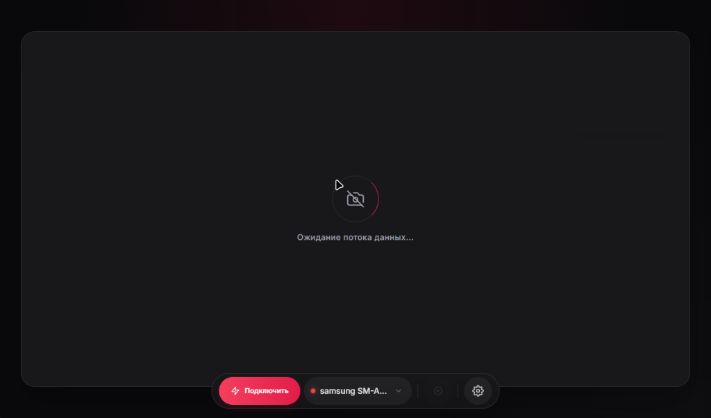

# VirtualCamNative - PC Client & Virtual Driver

> Ultra-Low-Latency, High-Performance DirectShow & Media Foundation Virtual Camera and Microphone for Windows powered by Android hardware acceleration.

<p align="center">
  <b>Language / Мова / Язык:</b><br>
  <a href="#virtualcamnative---pc-client--virtual-driver">English</a> • 
  <a href="#virtualcamnative---руководство-на-русском">Русский</a> • 
  <a href="#virtualcamnative---посібник-українською">Українська</a>
</p>

[](https://github.com/dimalinau-lab/Virtual-Camera/releases)
[](https://isocpp.org/)
[](https://docs.microsoft.com/en-us/windows/win32/directshow/directshow)
[](https://ffmpeg.org/)
[](https://www.microsoft.com/)
[](https://github.com/dimalinau-lab/Virtual-Camera-Android)
[](LICENSE)

<p align="center">
  
  <br>
  <em>VirtualCamNative Desktop Dashboard (Bento Dark Glass UI with device selector and quick action dock)</em>
</p>

**VirtualCamNative** is an open-source, high-efficiency desktop client and system driver written in pure **C++20**. Serving as a modern, lightweight alternative to proprietary solutions like DroidCam and Iriun, it receives hardware-accelerated **HEVC (H.265)** video and raw 48 kHz PCM audio over USB or Wi-Fi. The stream is converted on-the-fly and fed into native **DirectShow / Media Foundation virtual camera and microphone devices**, providing a plug-and-play experience in **Discord, OBS Studio, Zoom, Telegram, and WebRTC browsers** with ultra-low latency.

---

## Technical Specifications

| Parameter | Specification | Details |
| :--- | :--- | :--- |
| **Video Resolutions** | 1080p FHD (1920x1080), 4K UHD (3840x2160), 720p HD (1280x720) | Configurable dynamically without stream teardown |
| **Frame Rates** | 60 FPS, 30 FPS | Hardware native rate & D3D11 GPU / AVX2 frame interpolation |
| **Glass-to-Glass Latency** | ~10–15 ms (USB 3.0), < 30 ms (Wi-Fi 5 GHz) | Zero-copy NV12 pipeline and unbuffered TCP streaming |
| **Video Codec** | HEVC / H.265 | Android MediaCodec hardware encoder + PC NVDEC / FFmpeg |
| **Audio Stream** | 48 kHz, 16-bit Mono/Stereo PCM | Dedicated uncompressed TCP audio stream |
| **Virtual Drivers** | DirectShow & Media Foundation COM | `NativeMFVirtualCam.dll` ("Native High-Speed Cam" & "VirtualCam Native Microphone") |
| **Network Ports** | `8000` (Web UI/API), `8080` (Phone API), `8554` (Video TCP), `8555` (Audio TCP), `8888` (UDP Discovery) | Automatic ADB forwarding over USB |
| **OS Compatibility** | Windows 10 / Windows 11 (x64) | Companion app requires Android 8.0+ (API 26-35) |

---

## Key Features

### Video & Rendering Pipeline
- **Ultra-Low-Latency Pipeline (~10–15 ms)**: Single-pass color conversion (Fast Bilinear BGRA to NV12) with zero dynamic allocations on the critical rendering path.
- **Smooth 60 FPS via D3D11 & AVX2 Frame Blending**: Hardware-accelerated pixel averaging (`_mm256_avg_epu8`) and GPU shaders synthesizing smooth 60 FPS motion in ~0.2 ms with minimal CPU impact.
- **Anti-Bufferbloat Socket Management**: Non-blocking queue inspection via `ioctlsocket(FIONREAD)` with proactive frame-dropping safeguards to eliminate accumulated streaming lag over USB and Wi-Fi.
- **Sensor-Aware Geometric Transformation**: Direct portrait transposition resolving sensor orientation issues for both back and front cameras with hardware mirroring and 180° inversion.
- **Dual Virtual Driver Architecture**: A native COM filter (`NativeMFVirtualCam.dll`) feeding both camera frames and microphone audio through synchronized Windows Shared Memory (Memory-Mapped Files + Win32 Events).

### Studio Optics & 3D LUT Color Engine
- **Direct3D 11 GPU Acceleration**: Hardware shader execution of color correction matrix and 3D LUT grading directly on GPU with zero CPU overhead.
- **Physical Lens Switching & Digital Framing**:
  - Direct hardware optical lens selection: **0.5x Ultra-Wide**, **1x Wide**, and **2x / 3x Telephoto** via Camera2 `CONTROL_ZOOM_RATIO`.
  - Digital Zoom (1.0x to 4.0x) with real-time Pan (X, Y) framing.
- **Real-Time Color Matrix & 3D LUT Grading**:
  - Brightness (-100 to +100) and Contrast (50% to 200%).
  - Saturation (0% to 200%) and Color Temperature (-50 Warm to +50 Cool).
  - Built-in cinematic 3D LUT film profiles: Neutral, Cine Teal & Orange, Golden Hour, Emerald Matrix, Noir B&W, Cyber Neon.
- **AI Neural Background Engine**: Real-time background manipulation: Bokeh Blur (custom radius/softness), Green Screen chroma replacement, and Dark Studio lighting.

### Advanced Audio Suite
- **Lip-Sync Compensation Delay (0–500 ms)**: Circular ring-buffer delaying PCM audio samples to achieve frame-perfect audio-video synchronization.
- **Studio Noise Gate DSP**: Real-time suppression of keyboard clicking and cooling fan rumble with adjustable RMS threshold, instantaneous attack, and smooth exponential decay.
- **RNNoise AI Neural Noise Suppression**: Deep-learning neural voice filter eliminating constant air conditioning, PC fans, and ambient background rumble while preserving vocal clarity.
- **Transient Switch De-Clicker**: High-slew transient detector suppressing sharp mechanical keyboard clicks and mouse switches by up to -16 dB.
- **Automatic Gain Control (AGC) & Soft Limiter**: Dynamic speech leveling with up to +12 dB boost for quiet microphones, protected by a soft-knee limiter against clipping distortion.
- **3-Band Parametric Equalizer**: Studio biquad filters: Low-shelf (120 Hz, Bass body), Peaking (2.2 kHz, Vocal clarity), and High-shelf (7.5 kHz, Air brilliance), adjustable from -15 dB to +15 dB.
- **WASAPI Virtual Microphone Routing**: Dedicated DirectShow virtual microphone capture filter ("VirtualCam Native Microphone") streaming phone audio directly to Discord, OBS, and browsers without collision with external virtual cables.

### Troll FX Distortion Suite
Built-in real-time stream distortion executed directly in the rendering and DSP pipelines without latency penalties:
- **GSM 2G Cellphone Buzz**: Physical TDMA 216.7 Hz speaker buzz on speech (VAD mode) + classic incoming call handshake burst (<kbd>Ctrl</kbd> + <kbd>Shift</kbd> + <kbd>G</kbd>).
- **Tactical Walkie-Talkie**: Bandpass Chebyshev (380 Hz - 3.1 kHz), preamp overdrive, and dual-tone Roger Beep with static squelch.
- **Cyborg / Dalek Robot Voice**: 60 Hz ring-modulator carrier voice.
- **90s Camcorder / CCTV**: CRT scanlines, blinking red REC dot, live OSD timer, and battery indicator.
- **Fake Lag / Stutter**: Simulated network packet drops with frame freezing and audio dropouts.
- **Nuclear Flashbang / Overexposure**: Exponential bloom turning light sources into blinding flares.
- **144p Pixelate**: Dynamic block downscaling (144p / ATM security camera look).
- **VHS Glitch**: Randomized horizontal scanline tearing and color jitter.
- **90s Bitcrush**: 16-bit retro color palette quantization.
- **5 FPS Slideshow**: Simulated heavy packet loss and network stutter.

### Desktop UX & Triple Design System
- **3 Switchable Design Systems (`config.json` persistent)**:
  - **Variant 1 - Arcane Cyber (`index.html`)**: Chamfered futuristic HUD with gothic accents and neon glow.
  - **Variant 2 - Motion Glass (`index2.html`)**: Modern Bento layout with Emil Kowalski spring physics, 1px borders, and frosted glassmorphism.
  - **Variant 3 - Classic Aqua (`index3.html`)**: Mac OS X Aqua pinstripes, brushed aluminum textures, gel buttons, and drop shadows.
- **Full Trilingual Localization**: English (EN), Ukrainian (UK), and Russian (RU).
- **System Tray & Clean Window Management**:
  - Configurable **Close to Tray** (`close_to_tray`): minimize to system notification area instead of closing, keeping virtual camera live.
  - Diagnostic Terminal Console hidden by default (`SW_HIDE`), toggleable via Settings UI and tray context menu.
- **Minimalist Telemetry HUD**: Real-time on-screen telemetry showing FPS, bitrate, battery temperature, and resolution; toggleable via hotkey `<kbd>Ctrl</kbd> + <kbd>Shift</kbd> + <kbd>H</kbd>`.
- **Global Win32 System Hotkeys**:
  - <kbd>Ctrl</kbd> + <kbd>Shift</kbd> + <kbd>M</kbd> : Mute / Unmute Microphone
  - <kbd>Ctrl</kbd> + <kbd>Shift</kbd> + <kbd>B</kbd> : Privacy Shield (Blackout shutter)
  - <kbd>Ctrl</kbd> + <kbd>Shift</kbd> + <kbd>C</kbd> : Flip Camera (Front / Back)
  - <kbd>Ctrl</kbd> + <kbd>Shift</kbd> + <kbd>H</kbd> : Toggle HUD Telemetry Overlay (FPS / Bitrate / Temp)
  - <kbd>Ctrl</kbd> + <kbd>Shift</kbd> + <kbd>T</kbd> : Toggle Troll FX Distortion
  - <kbd>Ctrl</kbd> + <kbd>Shift</kbd> + <kbd>G</kbd> : Trigger 2G GSM Incoming Call Buzz Burst

---

## Comparison with Existing Solutions

| Feature | VirtualCamNative (C++) | DroidCam | Iriun Cam |
| :--- | :---: | :---: | :---: |
| **Language & Runtime** | **Native C++20 (Zero-bloat)** | C++ / C# | C++ / Objective-C |
| **Video Codec** | **HEVC / H.265 (Hardware)** | H.264 / MJPEG | H.264 / HEVC |
| **Frame Rate** | **Smooth 60 FPS (Hardware & AVX2/GPU)** | Limited (Paid) | Limited |
| **Optics & 3D LUT** | **Yes (0.5x/1x/2x, Color DSP, 6 LUTs)** | No | No |
| **Lip-Sync & Noise Gate** | **Yes (0–500ms Delay + Gate DSP)** | No | No |
| **Troll FX & Shaders** | **Yes (Flashbang, 144p, Glitch, Bitcrush)** | No | No |
| **Modular UI Themes** | **Yes (Cyber, Bento Glass, Aqua)** | Fixed UI | Fixed UI |
| **System Tray & Hotkeys** | **Yes (Background stream + Hotkeys)** | Basic | Basic |
| **Latency (USB)** | **~10–15 ms** | ~40–70 ms | ~30–50 ms |
| **Bufferbloat Prevention** | **Yes (Automatic Queue Guard)** | No | Limited |
| **Wi-Fi Pairing** | **Auto-Discovery (UDP :8888)** | Manual IP Entry | mDNS / Bonjour |
| **License** | **100% Free & Open Source (MIT)** | Proprietary (Freemium) | Proprietary (Watermarked) |

---

## System Architecture

```text
 +---------------------------------------------------------------------------------+
 |                        ANDROID CLIENT (HARDWARE SOURCE)                         |
 |           ( https://github.com/dimalinau-lab/Virtual-Camera-Android )           |
 |                                                                                 |
 | [ Camera2 Source (0.5x/1x/2x/Macro/Front) ] -> [ MediaCodec H.265 ] -> [ TCP :8554 ]|
 | [ AudioRecord (Noise Suppressed) ]        -> [ Raw 48kHz PCM ]      -> [ TCP :8555 ]|
 | [ NanoHTTPD :8080 ] <------------- REST & Pairing <------- [ UDP Beacon :8888 ] |
 +----------------------------------------|----------------------------------------+
                                          | TCP Video/Audio / HTTP REST / UDP Beacon
                                          v
 +---------------------------------------------------------------------------------+
 |                        VIRTUALCAMNATIVE PC CLIENT (C++20)                       |
 |                                                                                 |
 |  [ DeviceDiscoveryService ] ───► [ Device Selector Dropdown ]                   |
 |  [ TcpReceiver ]                  [ AudioReceiver (Ring-Buffer + Noise Gate) ]  |
 |         │                                                                       |
 |         ▼ (Anti-Bufferbloat Queue Guard)                                        |
 |  [ NvdecDecoder (FFmpeg Low-Delay) ]                                            |
 |         │                                                                       |
 |         ▼                                                                       |
 |  [ 64x64 Block Rotator ] ───► [ Studio Optics & 3D LUT Color Engine ]           |
 |         │                                   │                                   |
 |         ▼                                   ▼                                   |
 |  [ Local MJPEG Preview :8000 ]     [ Win32 Shared Memory MMF ]                  |
 |         │                                   │                                   |
 |         ▼                                   │ Frame Buffer + Sync Events        |
 |  [ WebView2 Desktop GUI ]                   │                                   |
 |  (System Tray + Hotkeys)                    │                                   |
 +---------------------------------------------|-----------------------------------+
                                               v
 +---------------------------------------------------------------------------------+
 |                NATIVE VIRTUAL DRIVERS (DIRECTSHOW & MEDIA FOUNDATION)           |
 |                                                                                 |
 |  [ NativeMFVirtualCam.dll ]                                                     |
 |    ├── Video Capture Filter ("Native High-Speed Cam")                           |
 |    └── Audio Capture Filter ("VirtualCam Native Microphone")                    |
 +----------------------------------------|----------------------------------------+
                                          | DirectShow Capture Pins
                                          v
 +---------------------------------------------------------------------------------+
 |                              CONSUMING APPLICATIONS                             |
 |                                                                                 |
 |    Discord    |    OBS Studio    |    Zoom    |    Telegram    |    Browsers    |
 +---------------------------------------------------------------------------------+
```

---

## Quick Start

### Installation Options
- **Recommended (One-Click Setup):** Download and run **`VirtualCamNative_Setup_v3.0.0.exe`** from [Releases](https://github.com/dimalinau-lab/Virtual-Camera/releases). The installer automatically registers the virtual camera and microphone driver (`NativeMFVirtualCam.dll`).
- **Fast In-App Update (Seamless Hot-Swap):** If already installed, the client automatically downloads **`VirtualCamNative_Update.zip`** from GitHub Releases and hot-swaps all binaries and UI files seamlessly in ~2 seconds.
- **Android Companion App:** Download and install **`VirtualCam-v3.0.0.apk`** directly from the Releases page on your smartphone.
- **Manual / Portable:** Unpack `VirtualCamNative_Update.zip` and run `regsvr32.exe /s NativeMFVirtualCam.dll` as Administrator.

### Prerequisites
- **Operating System:** Windows 10 or Windows 11 (64-bit).
- **Companion App:** VirtualCam Companion installed on your smartphone (`VirtualCam-v3.0.0.apk`).
- **Visual C++ Redistributable:** 2015–2022 (x64) (included in installer).

### USB Connection (Lowest Latency & Maximum Stability)
1. Enable **USB Debugging** on your phone (*Settings -> Developer Options -> USB Debugging*).
2. Connect your phone to your PC via a USB cable.
3. Launch `VirtualCamNative.exe`.
4. Click **USB Connect** — ports `8080`, `8554`, and `8555` are mapped automatically via ADB.

### Wi-Fi Connection (Wireless)
1. Ensure your PC and smartphone are connected to the same Wi-Fi network (5 GHz recommended).
2. Launch `VirtualCamNative.exe`. Active devices are discovered automatically via UDP Beacon (`:8888`).
3. Select your device from the dropdown menu and click **Wi-Fi Connect**.
4. If connecting for the first time, tap **Allow** on the confirmation prompt on your smartphone screen.

---

## REST Control & Telemetry API

The embedded HTTP server running on port `8000` provides local status endpoints and forwards configuration commands to the Android device:

| Endpoint | Method | Payload / Query | Description |
| :--- | :---: | :--- | :--- |
| `/api/devices` | `GET` | - | Returns active discovered devices: `[{"id":"...","name":"...","ip":"...","port":8080}]`. |
| `/api/pair_device` | `POST` | `?ip=192.168.1.X` | Triggers a confirmation dialog prompt on the phone screen and acquires a trust token. |
| `/api/connect_adb` | `POST` | - | Forwards ADB ports (`8080`, `8554`, `8555`) and begins streaming over USB. |
| `/api/connect` | `POST` | `{"ip": "192.168.1.X", "auth_token": "..."}` | Validates auth token and initiates Wi-Fi stream. |
| `/api/disconnect` | `POST` | - | Safely shuts down video/audio reception sockets. |
| `/api/status` | `GET` | - | Returns active connection details, device name, and camera status. |
| `/api/telemetry` | `GET` | - | Returns real-time metrics: `{"fps": 60.0, "bitrate": "10 Mbps", "codec": "H.265"}`. |
| `/api/phone/set_config` | `POST` | `{"fps": 60, "bitrate": 10000000, "resolution": "1080p"}` | Dynamically changes resolution, target FPS, and bitrate. |
| `/api/phone/lens` | `GET`/`POST` | `?lens=0.5x \| 1x \| 2x \| 3x \| 5x \| macro \| front` | Switches camera sensor optics on the smartphone. |
| `/api/optics/color` | `GET`/`POST` | `?brightness=0&contrast=100&saturation=100&temp=0&preset=0` | Live studio color correction & 3D LUT selection. |
| `/api/optics/zoom` | `GET`/`POST` | `?zoom=1.0&pan_x=0.0&pan_y=0.0` | Digital zoom and pan framing. |
| `/api/optics/get` | `GET` | - | Returns current studio optics state. |
| `/api/optics/reset` | `GET`/`POST` | - | Resets zoom and color grading to defaults. |
| `/api/audio_delay` | `GET`/`POST` | `?ms=50` | Sets Lip-Sync compensation delay (0 to 500 ms). |
| `/api/noise_gate` | `GET`/`POST` | `?enabled=1&threshold=0.015` | Configures studio Noise Gate DSP. |
| `/api/audio_ai_noise` | `GET`/`POST` | `?enabled=1` | RNNoise AI neural background and fan noise suppression. |
| `/api/audio_agc` | `GET`/`POST` | `?enabled=1` | Automatic Gain Control & soft-knee limiter (+12 dB max boost). |
| `/api/audio_declicker` | `GET`/`POST` | `?enabled=1` | Suppresses mechanical keyboard & mouse transient clicks (-16 dB). |
| `/api/audio_eq` | `GET`/`POST` | `?low=0&mid=0&high=0` | 3-band parametric equalizer (Low 120Hz, Mid 2.2kHz, High 7.5kHz, ±15 dB). |
| `/api/multicam` | `GET`/`POST` | `?channel=1\|2&ip1=...&ip2=...` | Fast dual-camera channel switching between devices. |
| `/api/app_settings` | `GET`/`POST` | `?close_to_tray=1&show_console=0&show_hud_stats=0` | Live app preferences: tray minimize, console visibility, and HUD telemetry overlay. |
| `/api/update/check` | `GET` | - | Queries GitHub Releases API for latest available desktop release. |
| `/api/update/download` | `POST` | - | Triggers asynchronous background download of installer from GitHub. |
| `/api/update/status` | `GET` | - | Returns live download progress, speed, and status. |
| `/api/update/install` | `POST` | - | Launches installer with `/SILENT` switch and gracefully exits application. |
| `/api/get_config` | `GET` | - | Reads full JSON configuration file. |
| `/api/save_file` | `POST` | `{ ... }` | Persists user settings to `config.json`. |
| `/api/audio/devices` | `GET` | - | Returns active Windows WASAPI audio capture endpoints. |
| `/api/audio/device` | `GET`/`POST` | `?id=phone\|{GUID}` | Switches audio capture input between phone and local PC microphone. |
| `/api/troll` | `POST` | `?fps_5=1&pixelate=8&glitch=1&bitcrush=1&overexposure=1&gsm_voice=1&walkie_talkie=1&robot_voice=1&cctv=1&fake_lag=1` | Live Troll FX distortion parameters. |
| `/api/troll/gsm_burst` | `POST` | - | Triggers 1.4s 2G GSM incoming call handshake interference burst. |
| `/stream` | `GET` | - | Multipart MJPEG stream for client preview rendering. |

---

## Building from Source

### Requirements
- **CMake:** Version 3.20 or newer.
- **Compiler:** Microsoft Visual C++ (MSVC) v143 (Visual Studio 2022) with C++20 support.
- **FFmpeg:** Shared 64-bit build (version 6.x or 7.x) including `avcodec`, `avutil`, `swscale`.
- **OpenMP:** Enabled for SIMD and multi-core spatial transformations.

### Build Steps (CMake)
```cmd
git clone https://github.com/dimalinau-lab/Virtual-Camera.git
cd Virtual-Camera
cmake -B build -S . -DCMAKE_BUILD_TYPE=Release
cmake --build build --config Release
```
Output binaries and frontend assets are placed in `bin/` and `Release/`.

---

## Driver Registration

The application automatically registers required filters upon first run when executed with administrator privileges. To register or remove the COM driver manually:

```cmd
:: Register virtual camera and microphone driver (Run as Administrator)
regsvr32.exe /s bin\NativeMFVirtualCam.dll

:: Unregister driver
regsvr32.exe /u /s bin\NativeMFVirtualCam.dll
```

---

## Companion Android App

For the mobile streamer component, see the companion repository:  
**[Virtual-Camera-Android on GitHub](https://github.com/dimalinau-lab/Virtual-Camera-Android)**

---

## License

This project is licensed under the **MIT License**. See [`LICENSE`](LICENSE) for details.

---
---

# VirtualCamNative - Руководство на русском

> Высокопроизводительная виртуальная камера и микрофон DirectShow & Media Foundation для Windows со сверхнизкой задержкой, использующая аппаратное ускорение Android.

<p align="center">
  
  <br>
  <em>Панель управления VirtualCamNative (интерфейс Bento Dark Glass с выбором устройства и нижним доком управления)</em>
</p>

**VirtualCamNative** — это клиент и системный драйвер для Windows с открытым исходным кодом, написанный на чистом **C++20**. Являясь современной и легковесной альтернативой проприетарным решениям (DroidCam, Iriun), он принимает аппаратный видеопоток **HEVC (H.265)** и несжатый 48 кГц PCM-звук по кабелю USB или сети Wi-Fi. Поток на лету декодируется и передается в нативный **COM-драйвер виртуальной камеры и микрофона (DirectShow / Media Foundation)**, обеспечивая работу в **Discord, OBS Studio, Zoom, Telegram и WebRTC-браузерах** со сверхнизкой задержкой (~10–15 мс).

---

## Технические характеристики

| Параметр | Значение | Описание |
| :--- | :--- | :--- |
| **Разрешения видео** | 1080p FHD (1920x1080), 4K UHD (3840x2160), 720p HD (1280x720) | Горячее переключение без разрыва сессии |
| **Частота кадров** | 60 FPS, 30 FPS | Нативная частота и разгон через D3D11 GPU / AVX2 интерполяцию |
| **Задержка (Glass-to-Glass)** | ~10–15 мс (USB 3.0), < 30 мс (Wi-Fi 5 ГГц) | Конвейер NV12 zero-copy и передача без буферизации |
| **Видеокодек** | HEVC / H.265 | Аппаратный энкодер MediaCodec (Android) + NVDEC / FFmpeg (ПК) |
| **Аудиопоток** | 48 кГц, 16 бит PCM | Выделенный несжатый TCP-поток звука |
| **Виртуальные драйверы** | DirectShow & Media Foundation COM | `NativeMFVirtualCam.dll` ("Native High-Speed Cam" и "VirtualCam Native Microphone") |
| **Сетевые порты** | `8000` (Web UI/API), `8080` (Phone API), `8554` (Video TCP), `8555` (Audio TCP), `8888` (UDP Discovery) | Автоматический проброс портов через ADB при подключении по USB |
| **Совместимость с ОС** | Windows 10 / Windows 11 (x64) | Android-приложение требует Android 8.0+ (API 26-35) |

---

## Ключевые возможности

### Видеоконвейер и рендеринг
- **Сверхнизкая задержка (~10–15 мс по USB)**: Однопроходная цветовая конвертация (быстрый билинейный BGRA в NV12) без динамических выделений памяти на критическом пути рендеринга.
- **Плавные 60 FPS через D3D11 и AVX2 Frame Blending**: Аппаратное усреднение соседних пикселей (`_mm256_avg_epu8`) и пиксельные шейдеры GPU синтезируют плавный видеоряд 60 FPS за ~0.2 мс практически без нагрузки на CPU.
- **Защита от накопления задержки (Anti-Bufferbloat)**: Неблокующая проверка очереди сокета через `ioctlsocket(FIONREAD)` с упреждающим отбрасыванием устаревших кадров для предотвращения лагов.
- **Коррекция геометрии под сенсор**: Прямое транспонирование кадра для фронтальной и основной камер с аппаратным зеркалированием и разворотом на 180°.
- **Двойной виртуальный драйвер DirectShow / Media Foundation**: Нативный COM-модуль (`NativeMFVirtualCam.dll`) передает видео и звук через разделяемую память Windows Shared Memory (Memory-Mapped Files + события Win32).

### Студийная оптика Studio Optics & 3D LUT
- **Аппаратное ускорение Direct3D 11**: Вычисление матрицы цветокоррекции и интерполяция 3D LUT исполняются пиксельными шейдерами DirectX 11 с нулевой нагрузкой на центральный процессор.
- **Переключение физических объективов камеры смартфона**:
  - Прямой выбор модулей: **0.5x Ultra-Wide**, **1x Wide**, **2x / 3x Telephoto**, **Макро** и **Селфи** через аппаратный Camera2 API.
  - Цифровой зум (от 1.0x до 4.0x) с панорамированием (X, Y).
- **Цветокоррекция и кинематографические профили 3D LUT**:
  - Яркость (от -100 до +100) и Контрастность (от 50% до 200%).
  - Насыщенность (от 0% до 200%) и Цветовая температура (от -50 Теплый до +50 Холодный).
  - Встроенные кинематографические профили 3D LUT: Neutral, Cine Teal & Orange, Golden Hour, Emerald Matrix, Noir B&W, Cyber Neon.
- **Нейросетевые эффекты фона**: Размытие заднего плана (Bokeh Blur), хромакей (Green Screen) и затемнение студии (Dark Studio).

### Студийный звуковой тракт
- **Компенсация рассинхронизации звука и видео (0–500 мс)**: Кольцевой буфер задержки PCM для идеального попадания звука в артикуляцию губ.
- **Шумоподавитель Noise Gate DSP**: Устранение стука клавиш и шума кулеров ПК с настраиваемым порогом RMS, мгновенной атакой и плавным спадом.
- **Нейрофильтр шумоподавления RNNoise AI**: Нейросетевое подавление постоянного шума кондиционеров и кулеров без искажения голоса.
- **Подавитель кликов De-Clicker**: Анализатор импульсных всплесков, снижающий щелчки механической клавиатуры и мыши до -16 dB.
- **Автоматическая регулировка громкости (AGC) и компрессор**: Выравнивание речи с усилением до +12 dB для тихих микрофонов и защитой от перегрузок.
- **3-полосный параметрический эквалайзер**: Студийные фильтры: Низкие (120 Гц), Средние (2.2 кГц), Высокие (7.5 кГц), регулировка от -15 dB до +15 dB.
- **Выделенный виртуальный микрофон DirectShow**: Виртуальный микрофон "VirtualCam Native Microphone" направляет звук телефона напрямую в Discord, OBS и браузеры без конфликтов со сторонними виртуальными кабелями.

### Пакет эффектов искажения и троллинга (Troll FX)
- **Помехи 2G GSM связи**: Реалистичный TDMA-треск динамика на частоте 216.7 Гц при речи + тестовый сигнал входящего вызова (<kbd>Ctrl</kbd> + <kbd>Shift</kbd> + <kbd>G</kbd>).
- **Рация Walkie-Talkie**: Полосовой фильтр Чебышёва (380 Гц - 3.1 кГц), перегруз и сигнал окончания передачи Roger Beep.
- **Голос Робота / Киборга**: Кольцевая модуляция несущей частотой 60 Гц.
- **Камера наблюдения 90-х / CCTV**: ЭЛТ-строки, мигающий индикатор записи REC, таймкод OSD.
- **Искусственный лаг (Fake Lag)**: Симуляция сетевых потерь с замиранием кадров и аудио-дропами.
- **Светошумовая граната / Пересвет**: Экспоненциальный блум, превращающий свет в ослепляющие вспышки.
- **Пикселизация 144p**: Ступенчатое блочное снижение детализации.
- **Глитч VHS**: Смещение горизонтальных строк развертки и цветовой джиттер.
- **Биткраш 90-х**: Квантование цвета до 16-битной палитры.
- **Слайдшоу 5 FPS**: Симуляция сильных сетевых потерь.

### Интерфейс и системная интеграция
- **3 графических интерфейса с сохранением в `config.json`**:
  - **Arcane Cyber (`index.html`)**: Футуристический HUD в стиле киберпанк.
  - **Motion Glass (`index2.html`)**: Современный Bento Glass интерфейс с пружинной физикой и тонким стеклом.
  - **Classic Aqua (`index3.html`)**: Стиль Mac OS X Aqua с полосатой текстурой и гелевыми кнопками.
- **Трехъязычная локализация**: Английский (EN), Украинский (UK) и Русский (RU).
- **Работа в системном трее**:
  - Опция **Сворачивать в трей** (`close_to_tray`): окно сворачивается в область уведомлений Windows, удерживая трансляцию активной.
  - Консоль диагностики скрыта по умолчанию (`SW_HIDE`), доступна через меню трея.
- **HUD оверлей телеметрии**: Отображение FPS, битрейта, температуры батареи и разрешения; переключается горячей клавишей `<kbd>Ctrl</kbd> + <kbd>Shift</kbd> + <kbd>H</kbd>`.
- **Глобальные горячие клавиши Windows**:
  - <kbd>Ctrl</kbd> + <kbd>Shift</kbd> + <kbd>M</kbd> : Отключить / включить микрофон
  - <kbd>Ctrl</kbd> + <kbd>Shift</kbd> + <kbd>B</kbd> : Шторка приватности (Blackout)
  - <kbd>Ctrl</kbd> + <kbd>Shift</kbd> + <kbd>C</kbd> : Переключить камеру (Фронт / Основная)
  - <kbd>Ctrl</kbd> + <kbd>Shift</kbd> + <kbd>H</kbd> : Переключить HUD-телеметрию
  - <kbd>Ctrl</kbd> + <kbd>Shift</kbd> + <kbd>T</kbd> : Включить / выключить эффекты Troll FX
  - <kbd>Ctrl</kbd> + <kbd>Shift</kbd> + <kbd>G</kbd> : Запустить наводку помех GSM

---

## Быстрый запуск

### Способы установки
- **Рекомендуемый (в один клик):** Скачайте и запустите **`VirtualCamNative_Setup_v3.0.0.exe`** из раздела [Releases](https://github.com/dimalinau-lab/Virtual-Camera/releases). Инсталлятор автоматически регистрирует COM-драйвер виртуальной камеры и микрофона (`NativeMFVirtualCam.dll`).
- **Быстрое автообновление Hot-Swap:** При наличии установленной версии приложение загружает архив **`VirtualCamNative_Update.zip`** из GitHub Releases и заменяет файлы за 2 секунды.
- **Приложение Android:** Скачайте и установите **`VirtualCam-v3.0.0.apk`** со страницы релизов на телефон.
- **Портативная версия:** Распакуйте `VirtualCamNative_Update.zip` и выполните `regsvr32.exe /s NativeMFVirtualCam.dll` от имени администратора.

### Системные требования
- **ОС:** Windows 10 или Windows 11 (64-бит).
- **Смартфон:** Установленный клиент VirtualCam Companion (`VirtualCam-v3.0.0.apk`).
- **Visual C++ Redistributable:** 2015–2022 (x64) (включен в инсталлятор).

### Подключение по USB (Минимальная задержка)
1. Включите **Отладку по USB** на смартфоне (*Настройки -> Для разработчиков -> Отладка по USB*).
2. Подключите смартфон к ПК кабелем USB.
3. Запустите `VirtualCamNative.exe`.
4. Нажмите кнопку **USB Connect** — порты `8080`, `8554` и `8555` пробрасываются автоматически через ADB.

### Беспроводное подключение по Wi-Fi
1. Подключите ПК и смартфон к одной сети Wi-Fi (рекомендуется 5 ГГц).
2. Запустите `VirtualCamNative.exe`. Устройство определится автоматически через UDP Beacon (`:8888`).
3. Выберите телефон в списке и нажмите **Wi-Fi Connect**.
4. При первом сопряжении нажмите **Разрешить** в диалоговом окне на экране смартфона.

---

## Сборка из исходников

```cmd
git clone https://github.com/dimalinau-lab/Virtual-Camera.git
cd Virtual-Camera
cmake -B build -S . -DCMAKE_BUILD_TYPE=Release
cmake --build build --config Release
```

---

## Ручная регистрация COM-драйвера

```cmd
:: Регистрация драйвера виртуальной камеры и микрофона (от имени Администратора)
regsvr32.exe /s bin\NativeMFVirtualCam.dll

:: Отмена регистрации драйвера
regsvr32.exe /u /s bin\NativeMFVirtualCam.dll
```

---

## Лицензия

Проект распространяется под лицензией **MIT License**. Подробности в файле [`LICENSE`](LICENSE).

---
---

# VirtualCamNative - Посібник українською

> Високопродуктивна віртуальна камера та мікрофон DirectShow & Media Foundation для Windows із наднизькою затримкою та апаратним прискоренням Android.

<p align="center">
  
  <br>
  <em>Панель керування VirtualCamNative (інтерфейс Bento Dark Glass із вибором пристрою та нижнім доком керування)</em>
</p>

**VirtualCamNative** — це нативний клієнт і системний драйвер для Windows з відкритим вихідним кодом, створений на базі **C++20**. Він є сучасною високопродуктивною альтернативою комерційним програмам (DroidCam, Iriun) і транслює апаратний відеопотік **HEVC (H.265)** та нестиснений звук 48 кГц PCM через USB-кабель або мережу Wi-Fi. Потік декодується на льоту та передається безпосередньо у віртуальний драйвер **DirectShow / Media Foundation**, що забезпечує миттєву роботу в **Discord, OBS Studio, Zoom, Telegram та браузерах** із затримкою всього ~10–15 мс.

---

## Технічні характеристики

| Параметр | Значення | Опис |
| :--- | :--- | :--- |
| **Роздільна здатність** | 1080p FHD (1920x1080), 4K UHD (3840x2160), 720p HD (1280x720) | Миттєве перемикання без розриву з'єднання |
| **Частота кадрів** | 60 FPS, 30 FPS | Нативна частота та плавний розгін через D3D11 GPU / AVX2 інтерполяцію |
| **Затримка (Glass-to-Glass)** | ~10–15 мс (USB 3.0), < 30 мс (Wi-Fi 5 ГГц) | Конвеєр NV12 zero-copy та небуферизований потік TCP |
| **Відеокодек** | HEVC / H.265 | Апаратний енкодер MediaCodec (Android) + NVDEC / FFmpeg (ПК) |
| **Аудіопотік** | 48 кГц, 16 біт PCM | Окремий нестиснений TCP-потік звуку |
| **Віртуальні драйвери** | DirectShow & Media Foundation COM | `NativeMFVirtualCam.dll` ("Native High-Speed Cam" та "VirtualCam Native Microphone") |
| **Мережеві порти** | `8000` (Web UI/API), `8080` (Phone API), `8554` (Video TCP), `8555` (Audio TCP), `8888` (UDP Discovery) | Автоматичне перенаправлення портів через ADB по USB |
| **Сумісність з ОС** | Windows 10 / Windows 11 (x64) | Android-додаток вимагає Android 8.0+ (API 26-35) |

---

## Головні переваги та можливості

### Відеоконвеєр та рендеринг
- **Наднизька затримка (~10–15 мс через USB)**: Однопрохідна колірна конвертація BGRA в NV12 без виділення динамічної пам'яті під час обробки кадрів.
- **Плавні 60 FPS завдяки D3D11 та SIMD AVX2 Frame Blending**: Апаратне усереднення сусідніх кадрів векторними інструкціями `_mm256_avg_epu8` та шейдерами GPU синтезує плавний рух 60 FPS за ~0.2 мс без навантаження на процесор.
- **Захист від накопичення буфера (Anti-Bufferbloat)**: Неблокуючий моніторинг черги сокета через `ioctlsocket(FIONREAD)` зі своєчасним відкиданням застарілих кадрів.
- **Геометрична трансформація під орієнтацію сенсора**: Блокове транспонування кадру з підтримкою апаратного дзеркалювання та розвороту на 180°.
- **Подвійний віртуальний драйвер DirectShow / Media Foundation**: Нативний COM-модуль (`NativeMFVirtualCam.dll`) передає відео та звук через спільну пам'ять Windows Shared Memory (Memory-Mapped Files + події синхронізації Win32).

### Студійна оптика Studio Optics та 3D LUT
- **Апаратне прискорення Direct3D 11**: Обробка колірних матриць та інтерполяція 3D LUT виконується піксельними шейдерами GPU з нульовим навантаженням на процесор.
- **Перемикання фізичних об'єктивів смартфона**:
  - Прямий доступ до модулів: **0.5x Ultra-Wide**, **1x Wide**, **2x / 3x Telephoto**, **Макро** та **Селфі** через апаратний Camera2 API.
  - Цифровий зум (від 1.0x до 4.0x) із панорамуванням (X, Y).
- **Колірна корекція та кінематографічні профілі 3D LUT**:
  - Яскравість (від -100 до +100) та Контрастність (від 50% до 200%).
  - Насиченість (від 0% до 200%) та Колірна температура (від -50 Теплий до +50 Холодний).
  - Вбудовані кінематографічні профілі 3D LUT: Neutral, Cine Teal & Orange, Golden Hour, Emerald Matrix, Noir B&W, Cyber Neon.
- **Нейромережеві ефекти заднього плану**: Розмиття фону (Bokeh Blur), заміна зеленого фону (Green Screen) та студійне затемнення (Dark Studio).

### Професійний аудіотракт
- **Компенсація затримки Lip-Sync (0–500 мс)**: Кільцевий буфер затримки PCM для точної синхронізації звуку з артикуляцією.
- **Студійний шумопоглинач Noise Gate DSP**: Придушення шуму клавіатури та вентиляторів з регульованим порогом спрацьовування.
- **Нейрофільтр шумопоглинання RNNoise AI**: Глибоке придушення постійного фонового шуму комп'ютерних кулерів і кондиціонерів без спотворення тембру голосу.
- **Фільтр клацань De-Clicker**: Знижує гучність клацання механічних перемикачів клавіатури та миші до -16 dB.
- **Автоматичне регулювання гучності (AGC) та компресор**: Компенсація тихих мікрофонів з посиленням до +12 dB та м'яким лімітером.
- **3-смуговий параметричний еквалайзер**: Студійні biquad-фільтри: Низ (120 Гц), Середина (2.2 кГц), Верх (7.5 кГц), регулювання від -15 dB до +15 dB.
- **Виділений віртуальний мікрофон DirectShow**: Віртуальний мікрофон "VirtualCam Native Microphone" транслює звук телефону в Discord, OBS та браузери без конфліктів зі сторонніми віртуальними кабелями.

### Пакет ефектів спотворення та тролінгу (Troll FX)
- **Накладення GSM-наведення 2G**: Фізичний TDMA-тріск динаміка на частоті 216.7 Гц під час мовлення + звук вхідного виклику (<kbd>Ctrl</kbd> + <kbd>Shift</kbd> + <kbd>G</kbd>).
- **Військова рація Walkie-Talkie**: Смуговий фільтр Чебишова (380 Гц - 3.1 кГц), перевантаження та сигнал завершення передачі Roger Beep.
- **Голос Робота / Кіборга**: Кільцева модуляція опорною частотою 60 Гц.
- **Камера спостереження 90-х / CCTV**: Рядки ЕПТ-розгортки, блимаючий індикатор запису REC, екранний таймер OSD.
- **Штучний лаг (Fake Lag)**: Симуляція втрати мережевих пакетів із замиранням кадрів.
- **Світлошумова граната / Пересвіт**: Експоненційний блум, що перетворює джерела світла на яскраві спалахи.
- **Пікселізація 144p**: Ступеневе блочне зниження чіткості зображення.
- **Глітч VHS**: Зсув горизонтальних рядків розгортки та тремтіння кольору.
- **Біткраш 90-х**: Квантування кольору до ретро 16-бітної палітри.
- **Слайдшоу 5 FPS**: Симуляція важкого мережевого зависання.

### Інтерфейс користувача та системна інтеграція
- **3 стилі інтерфейсу зі збереженням у `config.json`**:
  - **Arcane Cyber (`index.html`)**: Футуристичний неоновий HUD.
  - **Motion Glass (`index2.html`)**: Сучасний Bento Glass дизайн з пружинною анімацією та тонким склом.
  - **Classic Aqua (`index3.html`)**: Стиль Mac OS X Aqua зі смугастою текстурою та гелевими кнопками.
- **Повна тримовна локалізація**: Англійська (EN), Українська (UK) та Російська (RU).
- **Робота в системному треї**:
  - Опція **Згортати в трей** (`close_to_tray`): програма ховається в область сповіщень Windows, продовжуючи активний стрім.
  - Консоль діагностики прихована за замовчуванням (`SW_HIDE`), доступна через меню трею.
- **HUD оверлей телеметрії**: Відображення FPS, бітрейту, температури батареї та роздільної здатності; перемикається хоткеєм `<kbd>Ctrl</kbd> + <kbd>Shift</kbd> + <kbd>H</kbd>`.
- **Глобальні комбінації клавіш Windows**:
  - <kbd>Ctrl</kbd> + <kbd>Shift</kbd> + <kbd>M</kbd> : Вимкнути / увімкнути мікрофон
  - <kbd>Ctrl</kbd> + <kbd>Shift</kbd> + <kbd>B</kbd> : Шторка приватності (Blackout)
  - <kbd>Ctrl</kbd> + <kbd>Shift</kbd> + <kbd>C</kbd> : Перемкнути камеру (Фронт / Основна)
  - <kbd>Ctrl</kbd> + <kbd>Shift</kbd> + <kbd>H</kbd> : Перемкнути HUD-телеметрію
  - <kbd>Ctrl</kbd> + <kbd>Shift</kbd> + <kbd>T</kbd> : Увімкнути / вимкнути ефекти Troll FX
  - <kbd>Ctrl</kbd> + <kbd>Shift</kbd> + <kbd>G</kbd> : Запустити перешкоди GSM

---

## Швидкий старт

### Варіанти встановлення
- **Рекомендований (в один клік):** Завантажте та запустіть **`VirtualCamNative_Setup_v3.0.0.exe`** з розділу [Releases](https://github.com/dimalinau-lab/Virtual-Camera/releases). Інсталятор автоматично зареєструє COM-драйвер віртуальної камери та мікрофона (`NativeMFVirtualCam.dll`).
- **Швидке безшовне автооновлення (Hot-Swap):** Програма завантажує компактний архів **`VirtualCamNative_Update.zip`** і замінює бінарні файли за 2 секунди.
- **Мобільний додаток Android:** Завантажте та встановіть **`VirtualCam-v3.0.0.apk`** зі сторінки релізів на свій смартфон.
- **Портативна версія:** Розпакуйте `VirtualCamNative_Update.zip` та виконайте реєстрацію `regsvr32.exe /s NativeMFVirtualCam.dll` від імені адміністратора.

### Системні вимоги
- **ОС:** Windows 10 або Windows 11 (64-біт).
- **Мобільний додаток:** Встановлений клієнт VirtualCam Companion (`VirtualCam-v3.0.0.apk`).
- **Visual C++ Redistributable:** 2015–2022 (x64) (входить до інсталятора).

### Підключення через USB (Найкраща якість та стабільність)
1. Увімкніть **Налагодження через USB** на смартфоні (*Налаштування -> Параметри розробника -> Налагодження через USB*).
2. Підключіть телефон до ПК через USB-кабель.
3. Запустіть `VirtualCamNative.exe`.
4. Натисніть **USB Connect** — порти `8080`, `8554` та `8555` перенаправляються автоматично через ADB.

### Бездротове підключення через Wi-Fi
1. Переконайтеся, що ПК та смартфон підключені до однієї мережі Wi-Fi (рекомендовано 5 ГГц).
2. Запустіть `VirtualCamNative.exe`. Пристрій визначиться автоматично через UDP Beacon (`:8888`).
3. Оберіть свій смартфон зі списку та натисніть **Wi-Fi Connect**.
4. Під час першого підключення натисніть **Дозволити** у діалоговому вікні на екрані телефона.

---

## Компіляція з вихідного коду

```cmd
git clone https://github.com/dimalinau-lab/Virtual-Camera.git
cd Virtual-Camera
cmake -B build -S . -DCMAKE_BUILD_TYPE=Release
cmake --build build --config Release
```

---

## Реєстрація віртуального COM-драйвера

```cmd
:: Реєстрація драйвера віртуальної камери та мікрофона (від імені Адміністратора)
regsvr32.exe /s bin\NativeMFVirtualCam.dll

:: Скасування реєстрації драйвера
regsvr32.exe /u /s bin\NativeMFVirtualCam.dll
```

---

## Ліцензія

Проєкт розповсюджується під ліцензією **MIT License**. Докладніше у файлі [`LICENSE`](LICENSE).
